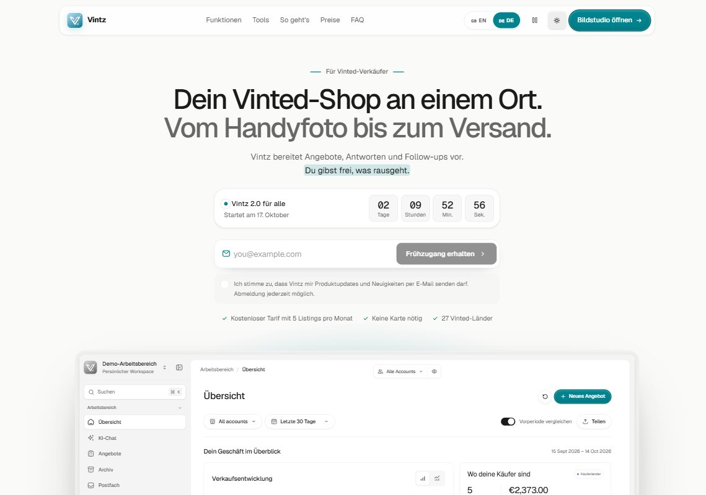
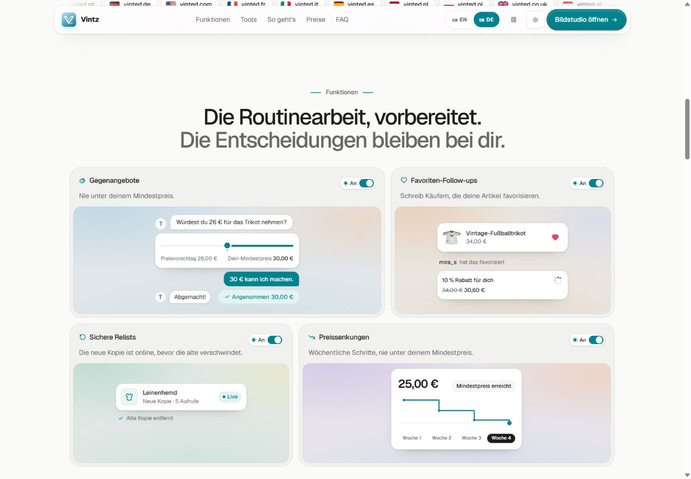
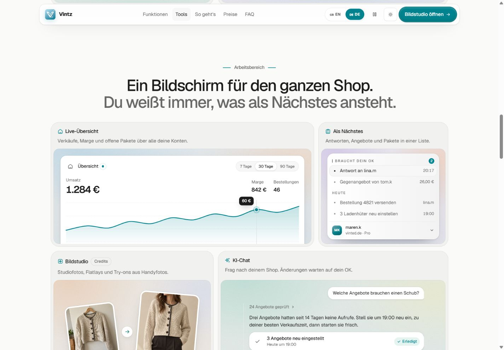
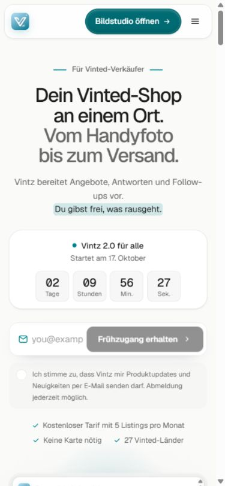

# Vintz: Analyse der Startseite und Vorlage für Flipbase

Stand: 14. Oktober 2026. Referenz: [vintz.ai](https://vintz.ai/).

## Ergebnis

Vintz ist eine gute Referenz für die visuelle Erklärung eines Softwareprodukts. Der starke Eindruck entsteht vor allem durch **kleine, animierte Produktoberflächen**: echte Texte, Karten, SVG-Diagramme, Statuswechsel und wenige Produktfotos. Die untersuchten Hauptszenen sind weder Videos noch GIFs noch eine große 3D-Szene.

Für Flipbase lohnt sich derselbe Aufbau: Nutzen erklären, Produkt zeigen, Abläufe demonstrieren, Preise klären, Fragen beantworten und zum Einstieg führen. Inhalt und Gestaltung müssen dabei Flipbase zeigen: mehrere Marktplätze, Einkauf, Bestand, Verkauf und Gewinn sowie das bestehende Logo-Gelb `#fcc601`.

Die SEO-Umsetzung von Vintz ist deutlich weniger überzeugend als das Design. Besonders relevant sind die Sprachumschaltung auf derselben URL, widersprüchliche Preisdaten im Schema, eine fehlerhafte Canonical-Zuordnung und die Sitemap. Diese Punkte sollten wir gezielt besser lösen.

## 1. Umfang und Verlässlichkeit

Geprüft wurden:

- Startseite im Browser bei **1440 × 1000** und **390 × 844 CSS-Pixeln**, einschließlich heller und dunkler Darstellung.
- Navigation, Menü, Funktionskarten, Ablaufsteuerung, beide Preisregister, FAQ und Frühzugangs-Dialog.
- Eingebettete Demo und ihre Navigation; keine Anmeldung, Registrierung, Zahlung oder Nachricht wurde abgeschickt.
- Öffentlich ausgeliefertes HTML, CSS und JavaScript, Bildressourcen, Metadaten, strukturierte Daten, robots.txt und Sitemap.
- Zehn öffentliche URLs aus Navigation und Sitemap auf HTTP-Antwort und zentrale Metadaten. Abschnittsanker wurden nicht als eigene Dokumente gezählt.
- Automatische Barrierefreiheitsprüfung mit dem bereits im Projekt vorhandenen axe-core 4.13.0.
- Aktuelle offizielle Dokumentation zu SEO, KI-Suche, Sprachversionen und Crawlern.
- Bestehende Flipbase-Landingpage im lokalen Repository, Stand `7cfeb90f`; der lokale Hauptzweig lag beim Beginn neun Commits hinter dem bekannten `origin/master`.

**Grenzen:** Kein Zugriff auf Vintz Search Console, Analytics, Conversions, Backlinks oder echte Kundenkonten. Keine belastbare Rankingposition, kein Suchvolumen und keine gemessene Conversion-Steigerung. Die öffentliche PageSpeed-API antwortete mit **HTTP 429 / ausgeschöpftem Kontingent**. Deshalb gibt es hier keinen erfundenen Lighthouse-Score und keine Aussage über bestandene Core Web Vitals. Die Browsermessungen sind Momentaufnahmen, kein Test auf einem echten Mobilgerät oder in Safari. GEO bezeichnet hier die Auffindbarkeit und korrekte Darstellung in generativen Suchsystemen.

Messdaten: [audit-evidence.json](vintz-2026-10-14/audit-evidence.json), [Mobilmaße](vintz-2026-10-14/mobile-measurements.json), [Ressourcen](vintz-2026-10-14/resource-measurements.json), [axe-Ergebnis](vintz-2026-10-14/accessibility-mobile.json). Screenshots zeigen unterschiedliche Zeitpunkte der Animationen; kleine Höhenunterschiede entstehen außerdem durch geöffnete FAQ und Preisregister.

## 2. Visuelle Dokumentation

### Einstieg

### Funktionskarten

### Arbeitsbereich

### Mobiler Einstieg

Weitere Aufnahmen: [ganze Desktopseite](vintz-2026-10-14/desktop-full.jpg), [mobile Karten](vintz-2026-10-14/mobile-features.jpg), [Ablauf mit Regeln](vintz-2026-10-14/desktop-workflow-rules.jpg), [Ablauf mit Freigabe](vintz-2026-10-14/desktop-workflow-review.jpg), [Preise](vintz-2026-10-14/desktop-pricing.jpg), [FAQ](vintz-2026-10-14/desktop-faq.jpg), [dunkle Darstellung](vintz-2026-10-14/desktop-dark.jpg), [Abschluss und Footer](vintz-2026-10-14/desktop-closing.jpg).

## 3. Seitenaufbau und Besucherführung

Die Seite führt vom allgemeinen Nutzen zu konkreten Abläufen und schließlich zur Anmeldung. Die folgenden Höhen stammen aus einem Desktopzustand mit geschlossenen FAQ und ausgewählten Monatstarifen; sie sind Messwerte dieser Aufnahme, keine starren Vorgaben.

| Reihenfolge | Bereich                                | Ungefähre Höhe | Aufgabe im Seitenablauf                                       |
| ----------- | -------------------------------------- | -------------: | ------------------------------------------------------------- |
| 1           | Schwebende, fixierte Navigation        |          58 px | Orientierung und jederzeit erreichbarer Einstieg              |
| 2           | Hero mit Formular, Countdown und Demo  |        1440 px | Zielgruppe, Nutzen, Freigabeprinzip und Produktbeweis         |
| 3           | Zwei laufende Länderreihen             |         148 px | Breite der unterstützten Märkte visualisieren                 |
| 4           | Vier Automatisierungskarten            |         959 px | Wiederkehrende Arbeit als verständliche Einzelszenen erklären |
| 5           | Sieben Karten zum Arbeitsbereich       |        1395 px | Breite des Produkts und Zusammenhang seiner Funktionen zeigen |
| 6           | Interaktiver Ablauf mit drei Schritten |         840 px | Einstieg und Kontrolle durch den Nutzer erklären              |
| 7           | Preise mit zwei Registern              |         992 px | Monatsabo und einmalige Bildguthaben auseinanderhalten        |
| 8           | FAQ mit Kontakt                        |         602 px | Einwände vor dem Einstieg beantworten                         |
| 9           | Dunkler Abschlussblock                 |         568 px | Entscheidung erneut anbieten                                  |
| 10          | Footer und großes Markenwort           |           Rest | Orientierung, Anbieterinformationen und visueller Abschluss   |

Die gesamte Seite war in diesem Zustand ungefähr **7638 px** lang. Es gibt kein verpflichtendes Scroll-Hijacking: Die Navigation springt zu Abschnitten, die Produktgeschichten laufen innerhalb ihrer Karten.

### Navigation

Die Navigationsleiste liegt mit Abstand zum oberen Rand über der Seite. Weiß beziehungsweise dunkel getönter Hintergrund, Transparenz, Blur, Schatten und abgerundete Ecken lassen sie als eigene Oberfläche erscheinen. Auf dem Desktop stehen fünf Abschnittslinks in der Mitte. Rechts folgen Sprache, Bewegungspause, Darstellung und Hauptaktion.

Mobil bleiben Logo, Hauptaktion und Menüknopf sichtbar. Sprache, Darstellung, Bewegungspause und Login wechseln in das Menü. Das ist nachvollziehbar, macht aber den Pausenschalter weniger direkt erreichbar.

### Hero

Der Einstieg verwendet eine kleine Zielgruppenzeile, eine sehr große zweigeteilte Überschrift und einen kurzen erklärenden Absatz. Die zweite Überschriftszeile ist grau. Ein kurzer Teil des Erklärungstextes bekommt eine animierte farbliche Markierung. Darunter stehen ein real datierter Start-Countdown, das E-Mail-Formular, die erforderliche Einwilligung und drei knappe Einstiegshinweise.

Der Countdown zählt auf **17.10.2026, 00:00 Uhr MESZ**. Das ist eine zeitgebundene Startkampagne und keine zeitlose Produktkomponente. Für Flipbase wäre er nur bei einem tatsächlichen Termin sinnvoll.

Die Demo beginnt auf dem Desktop erst weit unten im ersten Bildschirm. Mobil liegt praktisch der gesamte erste Bildschirm vor der Demo. Vorteil: sehr klare Textbotschaft. Nachteil: Der beste Produktbeweis kommt spät. Für Flipbase sollte der Hero kürzer sein und früher einen aussagekräftigen Produktausschnitt zeigen.

### Funktionsraster

Vier große Karten erklären jeweils genau einen Vorgang. Oben stehen Icon, Funktionsname und ein kurzer Nutzenhinweis. Darunter liegt eine farbige Bühne mit einer stark vereinfachten Produktoberfläche. Unterschiedliche Kartenbreiten verhindern ein monotones Raster. Die Reihen folgen auf dem Desktop **7/5** und **5/7** von zwölf Spalten.

Die dargestellten Schalter und Schaltflächen innerhalb der Bühnen sind zum Teil **Illustrationen**. Ein wie ein Button aussehender Freigabeschritt ist beispielsweise ein `span`. Die echten Bedienmöglichkeiten sind die Seitennavigation, Preisregister, Ablaufwahl, FAQ, Formulare und die eingebettete Demo. Dieser Unterschied muss beim Nachbau bewusst bleiben.

### Arbeitsbereich

Sieben weitere Karten vergrößern das Produktbild: Kennzahlen, Aufgaben, Bildbearbeitung, Assistenz, Versand, Kosten und Auswertung. Das Raster verwendet **8/4**, dann **5/7**, dann **4/4/4** Spalten. Jede Funktion erhält eine passend gewählte Darstellungsart: Zahlen und Kurve, Aufgabenliste, Fotopaar, Chat, Dokumentkarten, Rechnungsauszug oder Heatmap.

Das ist der eigentliche gestalterische Erfolgsfaktor: nicht siebenmal dasselbe Icon mit Text, sondern sieben unterschiedliche Beweise für den Nutzen.

### Ablauf, Preise, FAQ und Abschluss

Der Ablauf verbindet eine erklärende Auswahl links mit einer großen Bühne rechts. Drei Schritte wechseln automatisch im Abstand von **6,5 Sekunden**, solange der Bereich aktiv ist. Eine manuelle Auswahl beendet das automatische Weiterschalten in diesem Ablauf. Mobil werden daraus drei kompakte horizontale Auswahlen über der Bühne.

Die Preise stehen in einer gemeinsamen Fläche; die mittlere Karte wird durch eine weiße, angehobene Oberfläche betont. Die Monatsangebote liegen bei **9,90 / 27,90 / 49,90 €**, die einmaligen Bildpakete bei **9,90 / 19,90 / 39,90 €**. Das sind öffentlich beworbene Konditionen am Prüftag, keine überprüften Vertragsleistungen.

Die kostenlose Nutzung wird im Einstieg und in einer FAQ erklärt, hat im sichtbaren Monatsraster aber keine eigene Karte. Für einen Nutzer, der gezielt kostenlos beginnen will, ist dieser Übergang weniger klar als die Überschrift erwarten lässt.

Die acht FAQ verwenden native `details`/`summary`-Elemente. Die Antworten sind bereits im HTML enthalten. Der Abschluss setzt einen dunklen Gegenpol zur hellen Seite: konzentrische Ringe, zwei Aktionen und eine kleine Verkaufsszene. Der Footer beendet die Seite mit einem großen angeschnittenen Markenwort über einem Farbverlauf.

## 4. Gemessene Gestaltung

| Element                         | Nachgewiesene Ausprägung                                                            |
| ------------------------------- | ----------------------------------------------------------------------------------- |
| Schrift                         | Lokal geladene Geist und Geist Mono, WOFF2; Interface überwiegend Geist             |
| Seitenhintergrund hell          | `#fafaf9`                                                                           |
| Kartenhintergrund hell          | `#f1f1ef`                                                                           |
| Innere Produktoberflächen       | Vorwiegend Weiß                                                                     |
| Primärer Akzent                 | `#00838e`                                                                           |
| Sekundärer Text                 | Variable `--vint-muted: #6d6d6b` im hellen Grundthema                               |
| Seitenhintergrund dunkel        | `#0e0e0f`                                                                           |
| Kartenhintergrund dunkel        | `#151517`                                                                           |
| Hauptcontainer                  | Maximal 1200 px; Desktop-Innenabstände reduzieren das Kartenraster auf etwa 1136 px |
| Header                          | Maximal 1200 px, 58 px hoch, 16 px Radius                                           |
| Große H1                        | 56 px, Zeilenhöhe 57,68 px, Gewicht 500, Laufweite −2,8 px                          |
| H1 mobil                        | 34 px, Zeilenhöhe 35,02 px                                                          |
| H1 mittlere Breite              | CSS-Stufe 44 px ab `sm`                                                             |
| Abschnittsüberschriften Desktop | 46 px, Zeilenhöhe 48,3 px, Gewicht 500, Laufweite −2,07 px                          |
| Preisüberschriften              | 20 px, Zeilenhöhe 30 px, Gewicht 600                                                |
| Außenkarten                     | 24 px Radius, 8 px Innenabstand, feine innere Kontur                                |
| Farbbühnen                      | 16 px Radius, beschnittene Inhalte, feine innere Kontur                             |
| Rasterabstand                   | Ungefähr 12 px zwischen den großen Karten                                           |
| Abschnittsabstand               | Vertikal 56 px, ab `sm` 64 px, ab `lg` 80 px je Seite                               |
| Breite Beispielkarten           | Bei Desktop etwa 658/466, 753/371 und 371/371/371 px                                |

### Warum die Hintergründe hochwertig wirken

Eine Bühne besteht aus mehreren übereinanderliegenden **radialen CSS-Verläufen** und einer sehr schwachen Körnung. Die Körnung kommt aus einem eingebetteten SVG mit `feTurbulence`, nicht aus einem großen Hintergrundfoto. Es gibt vier Farbfamilien: kühles Blau, warmer Sand, Mint und helles Violett. Jeweils weiche Farbflecken sitzen in unterschiedlichen Ecken.

Beispiel für die blaue Familie: Basis `#e8eef2`, Akzente `#c9e0ec`, `#f3e1d3`, `#d9e9ee`. Die dunkle Darstellung verwendet eigene Werte und halbtransparente Farbflecken. Das Produkt im Vordergrund bleibt dadurch gut erkennbar, während die Fläche Tiefe bekommt.

Die Schatten sind klein und verteilt: Außenkontur, weicher Schatten unter der weißen Produktoberfläche, gelegentlich eine leichte innere Lichtkante. Es gibt keine dauerhaft harte schwarze Umrandung um jede Oberfläche.

**Übertragung:** dieselbe Ebenenbildung und ähnliche Dichte, mit Flipbase-Gelb als Akzent. Gelb auf Weiß eignet sich nicht für kleinen Informationstext. Dunkler Text, neutrale Konturen und Gelb für Flächen, Markierungen oder Fokus müssen getrennt eingesetzt werden.

## 5. Was hinter Bildern und Animationen steckt

### Nachgewiesener technischer Aufbau

Die öffentliche Ausgabe verwendet **Next.js/React**, Turbopack-Chunks, Tailwind-Klassen und CSS Modules. Im Code sind animierte React-Komponenten mit Ein-/Ausblendzuständen und Übergangsdefinitionen erkennbar. Die genaue Paketversion der Animationsbibliothek lässt sich aus dieser Untersuchung nicht zuverlässig bestimmen.

Die Landingpage enthält im äußeren Dokument **keine `video`- oder `canvas`-Elemente**, aber viele Inline-SVGs und ein `iframe`. Eine 3D-Engine oder Lottie-Datei ist für die untersuchten Hauptszenen nicht erforderlich. Das gilt für die beobachtete Landingpage, nicht für sämtliche internen Produktseiten.

Die Bilder sind wenige WebP-Dateien. Die restliche Wirkung entsteht durch:

- HTML-Karten mit echten Texten und Zahlen;
- SVG-Pfade, Icons und Diagramme;
- CSS-Verläufe, Masken, Ringe und Pseudoelemente;
- zeitlich gesteuerte Zustandswechsel;
- Transform-, Opacity- und kleine Blur-Übergänge;
- eine echte Demo in einem eigenen Dokument.

### Inventar der Bilddateien

| Motiv               |   Auflösung | Beobachtete dekodierte Dateigröße | Einsatz                             |
| ------------------- | ----------: | --------------------------------: | ----------------------------------- |
| Logo-Vorschau       |   256 × 256 |                       26.150 Byte | Header, Szenen und Footer           |
| Trikot              |   886 × 886 |                       51.792 Byte | Favoriten- und Ablaufdarstellung    |
| Strickjacke vorher  | 1122 × 1402 |                      196.814 Byte | Beispiel im Bildstudio              |
| Strickjacke nachher | 1122 × 1402 |                      169.012 Byte | Bearbeitetes Beispiel im Bildstudio |
| Hose                | 1600 × 1600 |                       77.696 Byte | Verkaufsszene im Abschluss          |

Das Fotopaar ist im Layout versetzt und leicht gedreht, mit weißem Rahmen und Schatten. Die eigentliche Transformation wird durch zwei fertige Fotos dargestellt. Es findet in der Landingpage keine nachgewiesene Live-Bildgenerierung statt.

Alle beobachteten `img`-Elemente verwenden Lazy Loading. Die dekorativen Produktbilder liegen überwiegend in `aria-hidden`-Szenen und haben leere Alternativtexte; das ist nicht pauschal ein Fehler. Wenn ein Vorher-/Nachher-Vergleich eine wesentliche Produkteigenschaft belegen soll, sollte Flipbase diese Eigenschaft zusätzlich als erreichbaren Text erklären.

### Bewegungsinventar

| Szene/Effekt      | Sichtbarer Ablauf                                                  | Technische Beobachtung                                                      |
| ----------------- | ------------------------------------------------------------------ | --------------------------------------------------------------------------- |
| Hero-Aufbau       | Kleine Zeile, Titel und Erklärung erscheinen gestaffelt            | 500 ms Reveal; Startversatz unter anderem 0/40/80/120 ms                    |
| Textmarkierung    | Farbfläche läuft unter einem kurzen Satz auf                       | 650 ms Verzögerung, 700 ms Laufzeit                                         |
| Statuspunkte      | Ring breitet sich um einen farbigen Punkt aus                      | CSS-Pseudoelement, 2,2 s Schleife                                           |
| Länderreihen      | Zwei Chipreihen laufen gegeneinander                               | Gemessen 44 s und 52 s; CSS-Basiswert 38 s wird überschrieben               |
| Mauslicht         | Sanfter Lichtfleck folgt dem Mauszeiger auf einer Karte            | Mausposition setzt CSS-Variablen; radialer Verlauf, 300 ms Einblendung      |
| Preisverhandlung  | Anfrage, Preisgrenze, Antwort und Zustimmung erscheinen            | HTML-Nachrichten, Zustandsfolge und animierte Elemente                      |
| Favoritenszene    | Produkt wird favorisiert, anschließend erscheint ein Rabattangebot | Herzimpuls, Ladezustand, fertige Nachricht; Zeitfolge insgesamt 8,2 s       |
| Wiedereinstellung | Alte und neue Produktkarte wechseln ihren Status                   | Neue Karte erscheint, alter Zustand verschwindet; Zeitfolge insgesamt 7,8 s |
| Preisreduktion    | Preis und Stufendiagramm ändern sich bis zur Untergrenze           | SVG und interpolierte Zahl; Zeitfolge insgesamt 6,5 s                       |
| Kennzahlen        | Zahl und Verlauf entwickeln sich gemeinsam                         | `requestAnimationFrame` für Zahlen, SVG für die Kurve                       |
| Aufgabenliste     | Einzelne Aufgaben oder Statusdetails treten hervor                 | Kleine Zustandswechsel innerhalb einer festen Kartenhöhe                    |
| Bildstudio        | Zwei bearbeitete Fotos zeigen vorher und nachher                   | WebP-Bilder mit Layout, Rahmen und Transform-Effekten                       |
| Assistenz         | Anfrage, Prüfung, Antwort und Ergebnis erscheinen                  | Wortweises Erscheinen, 70 ms pro Wort in der verwendeten Textkomponente     |
| Versand           | Mehrere Etiketten/Dokumente werden zusammengeführt dargestellt     | HTML-Dokumentkarten, SVG-Symbole und gestaffelte Übergänge                  |
| Kosten            | Verkauf, Einkauf, Beleg und Marge bilden eine kurze Geschichte     | Kleine UI-Ausschnitte statt eines großen Screenshots                        |
| Auswertung        | Zeitraster und markiertes gutes Zeitfenster                        | Raster aus DOM/SVG-Elementen, Akzentfläche und Glow                         |
| Ablaufwahl        | Drei größere Szenen wechseln automatisch oder per Klick            | Automatisch alle 6,5 s, manuelle Wahl stoppt den Wechsel                    |
| Preisregister     | Markierte Auswahl gleitet, Inhalt blendet ein                      | 300 ms Inhalts-Reveal, zwei getrennte Panels                                |
| Leuchtender Rand  | Lichtkante wandert um eine hervorgehobene Fläche                   | Maskierter konischer Verlauf, 2,6 s Rotation                                |
| FAQ               | Antwort öffnet sich unter der Frage                                | Native Offen-/Geschlossen-Semantik, etwa 350 ms Einblendung                 |
| Abschluss         | Verkaufskarte vor konzentrischen Kreisen                           | DOM/SVG/CSS-Komposition mit Produktbild                                     |

Der typische Einblendzustand einer kleinen Oberfläche kombiniert **8 px vertikalen Versatz, Skalierung 0,97, Opazität 0 und 2 px Blur**. Der Zielzustand liegt bei Skalierung 1, voller Sichtbarkeit und ohne Blur. Ein häufig verwendeter Übergang dauert **350 ms** mit `cubic-bezier(0.22, 1, 0.36, 1)`.

### Laufzeitsteuerung und Barrierefreiheit der Bewegung

Ein gemeinsamer Ablaufmechanismus prüft über `IntersectionObserver`, ob eine Szene sichtbar ist, berücksichtigt die Sichtbarkeit des Browserdokuments und stoppt bei manueller Pause oder `prefers-reduced-motion`. Die konfigurierte Observer-Schwelle liegt überwiegend bei 0,3 beziehungsweise 0,35; im Callback wird `isIntersecting` ausgewertet. Daraus sollte man keine exakt garantierte 30-Prozent-Startgrenze ableiten.

Die manuelle Pause wird für die Sitzung gespeichert. Bei eingeschalteter Pause waren die dauerhaften benannten CSS-Schleifen gestoppt; unmittelbar nach der Bedienung konnten noch kurze unbenannte Übergangsanimationen laufen. Mit emulierter Systemeinstellung für reduzierte Bewegung waren **keine laufenden benannten CSS-Animationen** mehr feststellbar. Die Emulation wurde anschließend zurückgesetzt.

Der Countdown ist ein zeitlicher Status und läuft unabhängig davon weiter. Die Pause der äußeren Landingpage belegt nicht, dass jede Bewegung innerhalb des Demo-Dokuments ebenfalls angehalten wird.

**Für Flipbase übernehmen:** Szenen außerhalb des Sichtbereichs stoppen, Endzustände ohne Animation verständlich halten, manuelle Pause anbieten und reduzierte Bewegung respektieren. Kleine, nachvollziehbare Ablaufsteuerung genügt; für diese Effekte muss kein neues Framework eingeführt werden.

## 6. Die eingebettete Demo

Der große Produktausschnitt ist ein `iframe` auf `/demo`, mit eigenem Titel und `loading="eager"`. Die Navigation zu `/demo/listings` wurde durch einen echten Klick ausgelöst. Das beweist eine navigierbare Demo, nicht die Funktionsfähigkeit eines verbundenen Vinted-Kontos.

Vorteil: Ein Besucher kann das Produkt vor einer Registrierung erkunden. Das schafft mehr Verständnis als ein statischer Dashboard-Screenshot.

Kosten und Grenzen:

- Das Dokument bringt eigene Oberfläche, Skripte, Diagramme und Navigation mit.
- Es wird sofort geladen und konkurriert damit um Bandbreite und Rechenzeit.
- Es entstehen zwei Scrollbereiche.
- Die eingebettete Oberfläche kann einen anderen Sprach- oder Darstellungszustand haben. Beim Wechsel der äußeren Seite ins dunkle Thema blieb die Demo in der beobachteten Aufnahme hell.
- Mobil war das innere Dokument 414 px breit; die äußere Darstellung passt es in den schmaleren Rahmen ein. Das verhindert nicht automatisch kleine Schrift oder schwierige Bedienung.

**Empfehlung für Flipbase:** Zuerst einen leichten Produktausschnitt mit einer verständlichen Kerninteraktion bauen. Eine größere Demo erst auf bewusste Aktion laden. Demonstrationsdaten klar kennzeichnen und vollständig von echten Nutzerdaten und produktiven Schreibaktionen trennen.

## 7. Responsive Verhalten und Bedienbarkeit

| Beobachtung                                                 | Bewertung für Flipbase                                                                                    |
| ----------------------------------------------------------- | --------------------------------------------------------------------------------------------------------- |
| Vier- und Sieben-Karten-Raster werden mobil einspaltig      | Übernehmen, aber die Anzahl sichtbarer Karten bewusst begrenzen                                           |
| H1 sinkt von 56 auf 34 px                                   | Gute Größenstaffelung; Umbrüche mit eigenen deutschen Texten prüfen                                       |
| Desktopnavigation wechselt zu kompakter Menüleiste          | Sinnvoll; Hauptaktion bleibt sichtbar                                                                     |
| Ablaufwahl wird horizontal und kurz                         | Gut, sofern die aktive Auswahl auch ohne Farbe erkennbar ist                                              |
| Drei Preiskarten stehen mobil untereinander                 | Erwartbar; kostenloser Einstieg muss trotzdem schnell auffindbar bleiben                                  |
| Seite wächst auf etwa 11.280 px                             | Sehr lang; mobile Priorisierung ist wichtiger als vollständige Desktopparität                             |
| Kein äußerer horizontaler Überlauf im gemessenen Zustand    | Positiv; `scrollWidth` 375 bei 390 px Viewport inklusive Scrollleiste                                     |
| Formular bleibt mobil in einer Reihe                        | E-Mail-Feld nur etwa 89 px, Senden-Button etwa 202 px: für Flipbase umbrechen                             |
| Formulareingabe und Senden sind 44 px hoch                  | Gute Ausgangsbasis für Touch; sichtbarer Eingaberaum bleibt das Problem                                   |
| Kleine Szenentexte häufig 10–13 px                          | Für dekorative Erklärung begrenzt geeignet; keine wesentlichen Informationen ausschließlich so vermitteln |
| Vergrößerte Schrift, 200-Prozent-Zoom und echte Touchgeräte | Nicht vollständig geprüft; verbindliche Abnahmefälle für den Nachbau                                      |

### Automatischer Accessibility-Befund

axe meldete **eine Verletzungsart an sechs Elementen: zu geringer Textkontrast**. Beispiele waren türkisfarbener Text auf heller Tönung mit Verhältnis **4,0:1** beziehungsweise **4,22:1**, sowie weißer sehr kleiner Text auf einem farbigen Freigabeelement mit **4,31:1**, jeweils unter dem erwarteten 4,5:1.

51 Regeln bestanden in diesem Test. 103 Kontrastfälle blieben zur manuellen Prüfung offen, ebenso die vollständige Prüfung des Frames. Das ist **kein Nachweis einer vollständigen WCAG-Konformität**. Die Befunde betreffen die geprüfte helle mobile Darstellung und den damaligen Szenenzustand.

Positiv sind benannte Bedienelemente, semantische Preisregister, eine beim Öffnen fokussierte E-Mail-Eingabe im Dialog, native FAQ und die Bewegungseinstellungen. Für Flipbase zusätzlich manuell prüfen: Tastaturreihenfolge, Fokusbegrenzung und -rückgabe im Dialog, Menübedienung, sichtbarer Fokus, kontrastreiche Zustände und die Bedienbarkeit der Demo.

## 8. Technisches SEO

### Was schon gut funktioniert

- Die Startseite antwortet mit HTTP 200 und liefert wesentlichen Text bereits im HTML.
- Es ist keine leere JavaScript-Hülle: Funktionsbeschreibungen, Szenentexte, Preise und FAQ-Antworten sind in der ersten Antwort enthalten.
- Ein Haupttitel, eine Meta-Beschreibung, ein Homepage-Canonical und erlaubende Indexierungsangaben sind vorhanden.
- Der englische HTML-Titel hat 55 Zeichen, die englische Meta-Beschreibung 149 Zeichen. Diese Längen sind Beobachtungen, keine festen Google-Grenzwerte.
- Echte Links verbinden Abschnitte und öffentliche Unterseiten. HTTPS und lokal geladene Schriftdateien sind vorhanden.
- Die Sitemap ist erreichbar und in robots.txt angegeben.

### Befunde und Prioritäten

| Priorität | Befund                                                 | Nachweis / Bedeutung                                                                                                 | Ableitung für Flipbase                                                                                              |
| --------- | ------------------------------------------------------ | -------------------------------------------------------------------------------------------------------------------- | ------------------------------------------------------------------------------------------------------------------- |
| Hoch      | Deutsch und Englisch teilen dieselbe URL               | HTML-Abruf liefert Englisch auch mit deutschem `Accept-Language`; Browser stellt auf Deutsch um; kein `hreflang`     | Deutsche Inhalte zuerst statisch ausliefern; bei echter zweiter Sprache eigene URLs und gegenseitige Sprachverweise |
| Hoch      | Schema-Preis widerspricht dem sichtbaren Monatsangebot | `SoftwareApplication.offers.highPrice` = 39,90; sichtbarer höchster Monatstarif = 49,90                              | Eine gemeinsame Quelle für Preise, sichtbare Tabelle und strukturierte Angebote                                     |
| Hoch      | Strukturierte Daten erst nach JavaScript-Ausführung    | Im ersten HTML kein eigenständiger JSON-LD-Script; nach Rendering SoftwareApplication, Product und FAQPage vorhanden | Passendes JSON-LD schon in HTML/Prerender ausliefern; erleichtert Zugriff auch ohne Rendering                       |
| Mittel    | Schema bleibt auf Englisch im deutschen Browserzustand | Englische Beschreibung und FAQ im gerenderten JSON-LD                                                                | Sprache und Inhalte der Daten mit der sichtbaren Sprachversion abstimmen                                            |
| Mittel    | Sitemap enthält `#pricing` und `#faq`                  | Abschnittsanker sind keine eigenständigen Dokumente                                                                  | Nur indexierbare kanonische Seiten in die Sitemap                                                                   |
| Mittel    | `lastmod` entspricht wiederholt dem Abrufzeitpunkt     | Erste Antwort 11:59:27 UTC, zweite 12:08:05 UTC; alle Einträge jeweils identisch                                     | Änderungsdatum aus wirklichen Inhaltsänderungen ableiten; Abrufzeit nicht als Aktualität ausgeben                   |
| Mittel    | `/privacy` zeigt Canonical auf die Homepage            | Eigenständige Datenschutz-Zusammenfassung mit unpassender Konsolidierung                                             | Selbstreferenzielles Canonical oder inhaltlich passendes Konsolidierungsziel                                        |
| Mittel    | `/pricing` beginnt mit H2, ohne H1                     | Im HTML und sichtbaren Aufbau kein eigener Haupttitel als H1                                                         | Eigenständige Seite mit eigenem H1 und eindeutiger Beschreibung                                                     |
| Mittel    | Metadaten werden im Browser teilweise doppelt          | Zwei Descriptions sowie doppelte OG-Titel nach Sprachaufbereitung beobachtet                                         | Metadaten kontrolliert ersetzen und pro Attribut eindeutig halten                                                   |
| Mittel    | Unterschiedliche Positionierung in Social-Metadaten    | Allgemeine Metadaten beschreiben Verkäuferverwaltung; Twitter-Angaben konzentrieren sich noch auf Bilder             | Produktversprechen über Titel, Social Cards und sichtbaren Einstieg synchronisieren                                 |
| Mittel    | Social-Bild ist nur quadratisches Logo                 | 1024 × 1024 als Bild einer großen Vorschau                                                                           | Eigenes querformatiges Vorschaubild mit Produktansicht und kurzer Aussage                                           |
| Mittel    | Wenig eigenständige Suchzielseiten                     | Navigation überwiegend auf Startseitenanker; Sitemap hauptsächlich Startseite, Preise und Rechtliches                | Fundierte Funktionsseiten für unterschiedliche Suchabsichten ergänzen                                               |
| Niedrig   | Deutsche Rechtstexte mit `html lang="en"` im Abruf     | Unter anderem AGB, Impressum und Datenschutz                                                                         | Korrekte Dokumentensprache schon im ausgelieferten HTML                                                             |
| Niedrig   | Titel der Preisseite nennt Marke doppelt               | Eigenständiger Titel und globale Titelvorlage scheinen sich zu überlagern                                            | Seitentitel und Titelvorlage gemeinsam prüfen                                                                       |
| Prüfen    | Dashboard in robots gesperrt, im HTML `index, follow`  | Eine Crawlsperre verhindert nicht zuverlässig die Indexierung einer bekannten URL                                    | Private App-Routen gesondert behandeln; Zugriffsschutz, Crawling und Indexierung sind verschiedene Aufgaben         |

Die Homepage hat genau ein H1 im äußeren Dokument. Ein weiteres H1 innerhalb des eigenständigen Demo-Dokuments ist nicht automatisch ein zweites H1 der Landingpage. Die Kartentitel sind teilweise `span role="heading" aria-level="3"`; das ist eine vorhandene Semantik, keine vollständig fehlende Überschriftenstruktur. Für Flipbase wären native H3-Elemente einfacher.

### Link- und Indexierungssicht

Die zehn überprüften öffentlichen Ziele lieferten HTTP 200. Damit wurde kein kaputter Link in dieser Stichprobe nachgewiesen. Das ist keine vollständige Prüfung aller internen Produktrouten. `/demo` liefert ausdrücklich `noindex, nofollow` und ist damit als Demo von regulären Suchzielseiten getrennt.

Eine Suchmaschinenabfrage zeigte die Vintz-Homepage als Ergebnis. Das belegt ihre Auffindbarkeit in dieser Suchquelle, aber weder eine vollständige Google-Indexabdeckung noch gute Rankings für allgemeine Suchbegriffe.

robots.txt erlaubt den öffentlichen Bereich und sperrt mehrere App-/Auth-Pfade. Es gibt keine spezielle Sperre für die öffentlich geprüften KI-Suchcrawler. Cloudflare wird als Auslieferungsschicht sichtbar; ob dessen Schutzregeln verifizierte Crawler tatsächlich durchlassen, ist ohne entsprechende Zugriffsprotokolle nicht bewiesen.

## 9. Ladeaufwand und Performance

Aus der ersten HTML-Antwort wurden **301.660 Byte HTML**, **759.961 Byte CSS** und **1.351.555 Byte referenziertes JavaScript** ermittelt. Das sind **unkomprimierte Inhaltsgrößen**, nicht die über das Netz übertragenen komprimierten Größen. Weitere dynamische Dateien und das Demo-Dokument kommen hinzu.

In einer späteren Browseraufnahme hatte das äußere Dokument 75 Ressourceneinträge mit zusammen etwa **1,48 MB Transfergröße** und **4,14 MB dekodierten Inhalten**. Cache, Cross-Origin-Sichtbarkeit und separat geladene Frame-Ressourcen begrenzen die Aussage. Diese Zahlen sind kein vollständiges Seitengewicht unter standardisierten Bedingungen.

Auffällig ist, dass in den Landingpage-Styles auch zahlreiche interne Produktkomponenten enthalten sind. Zusammen mit der sofort geladenen Demo ist das ein nachvollziehbarer Optimierungsansatz. Daraus lässt sich noch keine konkrete schlechte LCP-, INP- oder CLS-Zahl ableiten.

Für Flipbase schlage ich als Abnahmekriterien vor:

- Text, Hauptaktion und Produktvorschau ohne große Demo-Abhängigkeit ausliefern.
- Animationscode pro sichtbarem Bereich sparsam starten; keine unendlichen Timer für unsichtbare Szenen.
- Größe und Seitenverhältnis für Bilder und Szenen reservieren, damit beim Laden nichts springt.
- Eigene WebP-/AVIF-Fotos in benötigten Größen; Vorher-/Nachher-Fotos später laden.
- Produktdemo erst nach Klick oder bewusstem Näherkommen nachladen, mobil bevorzugt nach Klick.
- Statische Fallbacks ohne JavaScript und bei reduzierter Bewegung prüfen.
- Reale LCP/INP/CLS-Messung nach Umsetzung mit reproduzierbarem Laborprofil und später Felddaten. Eine gute Momentaufnahme auf einem Entwicklungsrechner genügt nicht.

## 10. GEO: Auffindbarkeit und richtige Antworten in KI-Suchen

GEO verlangt zuerst verständliche, zugängliche und widerspruchsfreie Inhalte. Google nennt für seine KI-Suchfunktionen keine zusätzliche Spezialdatei und kein besonderes KI-Schema als Voraussetzung. Bestehende SEO-Grundlagen bleiben maßgeblich. [Google: KI-Funktionen](https://developers.google.com/search/docs/appearance/ai-features)

`llms.txt` und `llms-full.txt` liefern bei Vintz 404. Das ist **kein nachgewiesener SEO-Fehler**. Google hat im Juni 2026 ausdrücklich klargestellt, dass `llms.txt` seine Sichtbarkeit und Rankings weder positiv noch negativ beeinflusst. Eine solche Datei kann für andere Systeme nützlich sein, ist hier aber keine vorrangige Maßnahme. [Google: Aktualisierungen](https://developers.google.com/search/updates)

### Stärken und Lücken

| Kriterium                       | Vintz-Befund                                                                    | Empfehlung für Flipbase                                                                                     |
| ------------------------------- | ------------------------------------------------------------------------------- | ----------------------------------------------------------------------------------------------------------- |
| Klares Produktverständnis       | Zielgruppe und zentrale Aufgabe früh erkennbar                                  | Ein eindeutiger Satz: was Flipbase ist, für wen und für welche Marktplätze                                  |
| Zitierfähige Antworten          | FAQ mit konkreten Leistungen und Grenzen                                        | Kurze direkte Antworten, anschließend Details und Verweise                                                  |
| Konsistente Fakten              | Preiswiderspruch und Sprachmischung                                             | Preise, Limitierungen und Verfügbarkeit aus gepflegter gemeinsamer Quelle                                   |
| Stabile Themen-URLs             | Meist nur Abschnitte der Startseite                                             | Eigene URLs für Vinted, Bestandsverwaltung, Bildbearbeitung, Preise und Hilfe, soweit tatsächlich abgedeckt |
| Anbieter als erkennbare Einheit | Marke und Rechtliches vorhanden; kein Organization-Knoten im beobachteten Graph | Organisation mit stabiler `@id`, Website und Software sinnvoll verbinden; nur echte Profile verknüpfen      |
| Belege                          | Produktdemo und Fotobeispiele                                                   | Eigene Beispiele, nachvollziehbare Screenshots, dokumentierte Messmethoden                                  |
| Externe Bestätigung             | In diesem Audit nicht ausreichend erhoben                                       | Authentische Erfahrungsberichte und unabhängige Erwähnungen; keine erfundenen Kennzahlen                    |
| Aktualität                      | Startdatum sichtbar; Sitemap-Aktualität fragwürdig                              | Tatsächliche Aktualisierungsdaten und gepflegte Funktionsverfügbarkeit                                      |
| Abrufbarkeit ohne JavaScript    | Englische Inhalte vorhanden, JSON-LD erst nach Rendering                        | Deutsche Kernaussagen und strukturierte Daten schon in der HTML-Antwort                                     |
| Crawlerzugang                   | Öffentliche Pfade in robots.txt erlaubt                                         | KI-Suche, Training und nutzergesteuerte Abrufe bewusst getrennt behandeln                                   |

Für ChatGPT-Suche ist **OAI-SearchBot** relevant. **GPTBot** betrifft das Modelltraining; beide Einstellungen können unabhängig voneinander gesetzt werden. Eine Freigabe für Suche verpflichtet deshalb nicht automatisch zur Freigabe für Training. [OpenAI: Crawler](https://developers.openai.com/api/docs/bots)

### Wichtige Aktualisierung zu FAQ-Markup

Eine FAQ bleibt für Besucher und klare Antworten sinnvoll. Es wäre jedoch falsch, für diesen Nachbau Google-FAQ-Rich-Results als Vorteil zu versprechen: Laut aktueller Google-Dokumentation erscheint dieses Suchergebnisformat seit **7. Mai 2026** nicht mehr. `FAQPage` ist damit kein begründetes Versprechen auf eine besondere Darstellung in Google. [Google: Dokumentationsänderungen](https://developers.google.com/search/updates)

### Konkreter Inhalt für Flipbase

Eine später zu belegende Produktdefinition könnte lauten: „Flipbase organisiert dein Reselling von Einkauf und Bestand bis zu Verkauf und Gewinn. Du arbeitest mit deinen Artikeln und den unterstützten Marktplätzen in einer gemeinsamen Übersicht.“ Die endgültige Fassung muss den tatsächlich freigegebenen Funktionsumfang nennen.

Wichtige Fragen für eigene, klare Antworten:

- Welche Marktplätze unterstützt Flipbase und welche Funktionen stehen je Marktplatz zur Verfügung?
- Welche Arbeitsschritte laufen automatisch und welche brauchen eine Freigabe?
- Wie werden Einkaufskosten, Gebühren und Gewinn dargestellt?
- Welche Funktionen erfordern ein geöffnetes Browserfenster oder eine Erweiterung?
- Welche Grenzen haben Bildbearbeitung, Synchronisierung und Exporte?
- Was kosten die Tarife und welche Limits gelten?
- Wie kann ich Daten exportieren und den Dienst verlassen?
- Welche Funktion ist schon verfügbar, in Beta oder erst geplant?

Jede Antwort sollte auch außerhalb des Seitenkontexts verständlich sein. Eigene Zahlen nur mit Zeitraum, Definition und Messgrundlage veröffentlichen. Eine schöne Demonstration ist kein Beleg für echte Umsatzergebnisse.

### GEO-Erfolg messen

Vor Veröffentlichung eine feste Liste relevanter Fragen dokumentieren. Danach regelmäßig dieselben Fragen in denselben Sprachen und Systemen prüfen: Wird Flipbase genannt, wird die richtige URL zitiert, stimmen Preise und Funktionen? Zusätzlich Suchimpressionen, qualifizierte Besuche und abgeschlossene Einstiege beobachten. Einzelne KI-Antworten sind schwankend; eine einmalige Erwähnung beweist keine nachhaltige Sichtbarkeit.

## 11. Suchthemen und zusätzliche Inhaltsseiten

Die folgende Priorisierung bewertet **Produktnähe und Kaufabsicht**, nicht gemessenes Suchvolumen oder Ranking-Schwierigkeit. Suchvolumen, CPC und Difficulty sind für alle Einträge offen. Die bestehende [Flipbase-Keyword-Recherche](../landing/keyword-research.md) vom 27.09.2026 bleibt eine historische Grundlage; ihre Zahlen wurden hier nicht neu gemessen.

| Suchthema                       | Absicht                  | Priorität | Sinnvolles Ziel                                                   |
| ------------------------------- | ------------------------ | --------- | ----------------------------------------------------------------- |
| Reselling Software              | Produktvergleich         | Hoch      | Startseite                                                        |
| Reseller Software               | Produktvergleich         | Hoch      | Startseite, natürlich eingebunden                                 |
| Reseller App                    | Produktvergleich         | Hoch      | Startseite mit klarer Web-/Mobilbeschreibung                      |
| Vinted Verkäufer Tool           | Produktvergleich         | Hoch      | Vinted-Funktionsseite                                             |
| Vinted Verwaltung               | Produktvergleich         | Hoch      | Vinted-Funktionsseite                                             |
| Vinted Bestandsverwaltung       | Konkretes Problem        | Hoch      | Bestand und Marktplatzzuordnung                                   |
| Reselling Bestandsverwaltung    | Konkretes Problem        | Hoch      | Bestandsseite                                                     |
| Vinted Gewinn berechnen         | Information/Werkzeug     | Hoch      | Erklärung mit nachvollziehbarem Beispiel                          |
| Reselling Gewinn berechnen      | Information/Werkzeug     | Hoch      | Gewinn-/Kostenübersicht                                           |
| Vinted Verkaufsübersicht        | Konkretes Problem        | Hoch      | Verkaufsübersicht                                                 |
| eBay und Vinted verwalten       | Produktvergleich         | Hoch      | Marktplatzvergleich mit tatsächlichem Umfang                      |
| Kleinanzeigen Warenverwaltung   | Konkretes Problem        | Mittel    | Passende Integration, sofern abgedeckt                            |
| Vinted Produktfotos verbessern  | Information/Produkt      | Mittel    | Bildbearbeitung mit eigenen Vorher-/Nachher-Beispielen            |
| KI Produktfotos Kleidung        | Produktvergleich         | Mittel    | Bildfunktion, nur soweit tatsächlich vorhanden                    |
| Reselling Excel Alternative     | Produktvergleich         | Hoch      | Sachlicher Workflow-Vergleich                                     |
| Vinted automatische Nachrichten | Konkrete Funktion        | Bedingt   | Nur bei real verfügbarer, korrekt beschriebener Funktion          |
| Vinted Artikel neu einstellen   | Anleitung/Funktion       | Bedingt   | Anleitung plus belegte Produktunterstützung                       |
| Vinted Bot                      | Gemischte Produktabsicht | Bedingt   | Fähigkeiten und Grenzen ausdrücklich erklären                     |
| Buchhaltung für Reseller        | Information/Produkt      | Mittel    | Tatsächliche Kosten-/Exportfunktionen klar abgrenzen              |
| Vintz Alternative               | Produktvergleich         | Später    | Datierten, nachprüfbaren Vergleich mit fairen Kriterien erstellen |

Die Suchstichprobe zeigte unter anderem Dressio und vintex.app mit eigenen deutschen Einstiegsseiten sowie mehrere Anbieter mit Browser-Erweiterungen. Das bestätigt unterschiedliche Nutzererwartungen im Themenfeld. Es liefert keine belastbare Aussage über deren Marktanteile, Domainautorität oder Rankingvorsprung. Primärquellen: [Dressio](https://dressio.app/de), [vintex.app](https://www.vintex.app/de).

Für Flipbase bleibt die breite Produktpositionierung sinnvoll. Eine rein auf Vinted verkürzte Kopie würde eBay, Kleinanzeigen und den Ablauf vom Einkauf bis zum Gewinn unsichtbar machen. Eine Startseite kann dieses Gesamtbild vermitteln; spezifische Suchanfragen benötigen ergänzende, inhaltlich eigenständige Seiten.

## 12. Übertragung auf die vorhandene Flipbase-Architektur

Die lokale Startseite liegt in **`landing/index.html` mit `landing/landing.js`**. Sie ist bereits eine separate statische Landingpage. Das Angular-Produkt und diese Marketingseite sollten bei der Planung getrennt betrachtet werden. Next.js ist keine Voraussetzung dafür, Vintz-ähnliche Szenen umzusetzen.

Im untersuchten lokalen Stand sind bereits vorhanden: deutscher HTML-Einstieg, Titel und Beschreibung, Canonical, Open-Graph-Grundangaben, robots.txt, Sitemap und dedizierte Landingpage-Tests. Im gelesenen HTML wurde kein JSON-LD und kein OG-Bildverweis gefunden. Die Sitemap enthält nur die Homepage. Vor einer Umsetzung muss das am aktuellen `origin/master` erneut abgeglichen werden.

| Thema               | Vintz                                                        | Flipbase im untersuchten lokalen Stand         | Entscheidung                                      |
| ------------------- | ------------------------------------------------------------ | ---------------------------------------------- | ------------------------------------------------- |
| Technische Ausgabe  | Next.js/React mit vorgerendertem Text und Client-Erweiterung | Statisches HTML plus JavaScript                | Statische Basis beibehalten                       |
| Produktfokus        | Ein Marktplatz und Fotostudio                                | Reselling über mehrere Marktplätze             | Eigenes breiteres Produktversprechen erhalten     |
| Visueller Beweis    | Elf kleine Szenen plus große Demo                            | Bestehende Landing-Komposition                 | Eigene Funktionsszenen hinzufügen                 |
| Markenakzent        | Türkis                                                       | Gelb `#fcc601`                                 | Flipbase-Gelb beibehalten                         |
| Sprachbasis         | Englisches HTML, deutsche Browserdarstellung                 | Deutsches HTML, zusätzliche Sprachanzeige      | Deutsche Suchversion nicht verschlechtern         |
| Strukturierte Daten | Clientseitig, mit Preiswiderspruch                           | Im gelesenen HTML nicht vorhanden              | Korrekte Daten aus gemeinsamer Quelle ergänzen    |
| Themenstruktur      | Wenige öffentliche Zielseiten                                | Homepage-Sitemap                               | Eigene hilfreiche Funktionsseiten planen          |
| Prüfungen           | Nur externe Beobachtung möglich                              | `test:landing` und Deploymentprüfung vorhanden | Bestehende Prüfwege erweitern und wiederverwenden |

## 13. Konkreter Aufbau für die neue Flipbase-Startseite

Dies ist ein Vorschlag für den nächsten Umsetzungsschritt, noch keine Änderung an der Seite.

| Abschnitt          | Inhalt für Flipbase                                                       | Visualisierung                                                         |
| ------------------ | ------------------------------------------------------------------------- | ---------------------------------------------------------------------- |
| Navigation         | Wenige klare Bereiche, Preise, Hilfe, Einstieg                            | Schwebende Leiste; mobil kompakt                                       |
| Hero               | Ein Satz zum Reselling-Ablauf, ein überprüfbarer Nutzen, eine Hauptaktion | Eigene Produktübersicht; früher sichtbar als bei Vintz                 |
| Marktplätze        | Tatsächlich unterstützte Plattformen                                      | Ruhige Reihe mit klaren Bezeichnungen; keine erfundene Reichweite      |
| Vier Kernvorteile  | Einkauf erfassen, Bestand ordnen, Verkauf verwalten, Gewinn verstehen     | Vier unterschiedliche kurze Szenen im wechselnden Raster               |
| Produktablauf      | Ein Artikel vom Einkauf bis zum Verkauf                                   | Drei wählbare Schritte mit zusammenhängenden Beispieldaten             |
| Weitere Funktionen | Nur wirklich relevante Zusatzfunktionen                                   | Drei bis fünf kleine Karten statt zwangsläufig sieben                  |
| Bildbearbeitung    | Tatsächlich vorhandene Bearbeitung mit überprüfbarem Ergebnis             | Eigene, gleichartig fotografierte Vorher-/Nachher-Beispiele            |
| Vertrauen          | Anbieter, Umgang mit Daten, echte Aussagen von Nutzern, Produktgrenzen    | Sachliche Belege statt Fantasiezahlen                                  |
| Preise             | Aktuelle Tarife und Limits                                                | Klare Vergleichskarten; kostenloser Einstieg sichtbar, falls angeboten |
| FAQ                | Kaufentscheidende Fragen und konkrete Grenzen                             | Native, zugängliche aufklappbare Antworten                             |
| Abschluss          | Derselbe nächste Schritt wie im Hero                                      | Dunkle Fläche mit gelbem Akzent und einer kurzen Verkaufsszene         |
| Footer             | Produktseiten, Hilfe, Unternehmen, Rechtliches                            | Eigene Markenkomposition                                               |

### Vier erste Szenen, die unmittelbar zu Flipbase passen

1. **Einkauf → Bestand:** Ein Artikel erhält Einkaufspreis und Bestandseintrag. Die Szene erklärt die Zuordnung anhand eines einzigen Produkts.
2. **Bestand → Angebot:** Ein vorhandener Artikel wechselt in einen tatsächlich unterstützten Angebotsablauf. Keine Veröffentlichung auf Plattformen versprechen, die diese Funktion nicht unterstützen.
3. **Verkauf → Gewinn:** Verkaufspreis, Einkauf und bekannte Kosten werden Schritt für Schritt zu einem nachvollziehbaren Ergebnis. Beispieldaten sichtbar kennzeichnen.
4. **Nachricht → Bearbeitung:** Ein Eingang wird als relevante Aufgabe sichtbar. Eine automatische Antwort nur zeigen, wenn sie zum freigegebenen Produktumfang gehört.

Für jede Szene vor Umsetzung festlegen: Anfangszustand, auslösender Schritt, sichtbare Änderung, Ergebnis, Pausen-/Ruhezustand, mobile Vereinfachung und zugängliche Textbeschreibung. Die Szene soll eine Funktion erklären, nicht nur Bewegung erzeugen.

### Benötigte eigene Assets

- Ein eigener Produktausschnitt für den Hero mit anonymisierten oder demonstrativen Daten.
- Zwei bis drei eigene Artikelbilder, die in mehreren Szenen wiederkehren.
- Ein echtes Vorher-/Nachher-Paar aus der vorhandenen Flipbase-Bildbearbeitung.
- Ein eigenes Social-Vorschaubild.
- Bestehendes Flipbase-Logo und vorhandene Icons.

Die Screenshots in diesem Bericht dienen der Analyse. Für die neue Seite werden eigene Texte, Bilder und UI-Kompositionen erstellt; Vintz-Dateien werden nicht als Flipbase-Produktassets eingebaut.

## 14. Priorisierter Ablauf

| Priorität | Arbeit                                                          | Ergebnis                                                     | Aufwand / Abhängigkeit                                              |
| --------- | --------------------------------------------------------------- | ------------------------------------------------------------ | ------------------------------------------------------------------- |
| 1         | Aktuellen Funktionsumfang und gültige Preise abgleichen         | Verbindliche Liste zulässiger Aussagen                       | Klein bis mittel; aktueller Produktstand nötig                      |
| 1         | Seitenstruktur und eigenen Hero formulieren                     | Eine klare Geschichte mit einer Hauptaktion                  | Mittel; vorhandene Keyword-Entscheidungen berücksichtigen           |
| 1         | Eine vollständige Szenenkarte auf Desktop und Mobil ausarbeiten | Messbare Vorlage für alle weiteren Karten                    | Mittel; eigene Beispieldaten und Markenfarben                       |
| 1         | HTML-, Sprach-, Canonical- und Schema-Konzept festlegen         | Suchmaschinenlesbare Grundlage                               | Mittel; URL-Struktur und Preisdaten müssen feststehen               |
| 2         | Vier Kernkarten und Drei-Schritt-Ablauf umsetzen                | Visuelle Produkterklärung                                    | Mehrere Tage; freigegebene Szenen und Assets                        |
| 2         | Formular, Preise und FAQ anpassen                               | Durchgehender Einstieg                                       | Mittel; bestehende Einwilligungs- und Registrierungslogik verwenden |
| 2         | Motion-Pause, reduzierte Bewegung und mobile Regeln prüfen      | Verständliche Seite für unterschiedliche Nutzungssituationen | Teil der Umsetzung, kein nachträgliches Extra                       |
| 2         | Bilder und Demo-Ladung optimieren                               | Geringerer initialer Aufwand                                 | Abhängig von fertigen Assets                                        |
| 3         | Erste thematische Unterseiten veröffentlichen                   | Mehr passende Suchziele                                      | Je Seite fundierter Inhalt erforderlich                             |
| 3         | Such- und KI-Sichtbarkeit beobachten                            | Wirkung und Faktenkorrektheit messbar machen                 | Nach Veröffentlichung; wiederholte vergleichbare Stichproben        |

Der sinnvollste nächste Schritt ist eine konkrete Flipbase-Komposition aus **Hero, einer fertigen Funktionskarte und einem Ablaufbeispiel**. Damit lassen sich Look, Texte, Bildqualität und Bewegungen beurteilen, bevor die gesamte Seite gebaut wird.

## 15. Abnahme für die spätere Umsetzung

- Desktop, Tablet und Mobil mit echten deutschen Texten; keine horizontalen Überläufe.
- Wesentliche Inhalte und korrekte Metadaten bereits in der HTML-Antwort.
- Preise und Funktionen stimmen zwischen Oberfläche, FAQ und Schema überein.
- Demo und dekorative Szenen sind für Nutzer klar unterscheidbar.
- Anfangs- und Endzustände bleiben ohne Bewegung verständlich.
- Keine versteckten produktiven Schreibaktionen in der Demo.
- Systempräferenz für reduzierte Bewegung und manuelle Pause funktionieren.
- E-Mail-Feld mobil ausreichend breit, Fokusführung korrekt, Fehlermeldungen verständlich.
- axe-Prüfung plus manuelle Tastatur-, Kontrast- und Zoomprüfung.
- Vorhandene Landingpage-Tests, relevante Format-/Lintprüfung und Produktionsprüfung passend zum Änderungsumfang.
- Reproduzierbare Performance-Messung; Screenshot oder lokaler schneller Seitenaufbau nicht als Core-Web-Vitals-Nachweis ausgeben.

## Quellen

Primäre Untersuchungsgrundlage: [Startseite](https://vintz.ai/), [Preisseite](https://vintz.ai/pricing), [Demo](https://vintz.ai/demo), [robots.txt](https://vintz.ai/robots.txt), [Sitemap](https://vintz.ai/sitemap.xml), [Privacy-Seite](https://vintz.ai/privacy), dazu die von diesen Seiten öffentlich referenzierten Ressourcen. Die konkreten Messdaten und Screenshots sind oben verlinkt.

Einordnung: [Google zu KI-Suchfunktionen](https://developers.google.com/search/docs/appearance/ai-features), [Google zu mehrsprachigen Websites](https://developers.google.com/search/docs/specialty/international/managing-multi-regional-sites), [Google-Dokumentationsänderungen 2026](https://developers.google.com/search/updates), [OpenAI-Crawler](https://developers.openai.com/api/docs/bots). Alle im Rahmen dieser Untersuchung am 14.10.2026 abgerufen.
