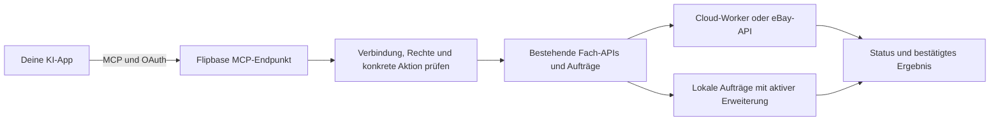

# KI-Verbindungen: Vintz-Analyse und Integrationsplan für Flipbase

Stand: 14. November 2026. Analyse und Planung, keine Implementierung.
Flipbase-Grundlage: frisch abgerufenes `origin/master`, Commit `718f46c4`.

**Fortgeschriebener Umsetzungsplan:** Der auf den aktuellen Flipbase-Bestand
angepasste [Implementierungsplan](../implementation/ai-connections.md) ersetzt
die nachfolgenden vorläufigen Architektur- und Etappenvorschläge. Die
Vintz-Befunde bleiben als Recherche erhalten.

## Ergebnis

Flipbase kann einen eigenen MCP-Server anbieten, über den Du in Deiner
verbundenen KI-App Artikel suchst, mit Fotos Anzeigen vorbereitest, Preise
änderst und Artikel erneut einstellst. Die KI-App übernimmt Sprachverständnis
und Planung; Flipbase prüft Rechte und Angaben und führt die Fachaktionen aus.
Für diesen Aufbau muss Flipbase keine eigene Modell-API aufrufen. Betrieb,
Marktplatzanbindung und gegebenenfalls zusätzliche Bild-KI bleiben eigene Kosten;
die Nutzung unterliegt weiterhin den Grenzen der gewählten KI-App.

Vintz liefert dafür eine brauchbare Produktvorlage. Der vollständige Servercode
bleibt verborgen. Nach der inzwischen erfolgreichen nativen OAuth-Anmeldung
sind die tatsächlichen 50 Werkzeugschemas und allgemeinen Server-Anweisungen
gelesen und im [MCP-Katalogbericht](2026-11-14-vintz-mcp-tool-catalog.md)
ausgewertet. Die Untersuchung unterscheidet sichtbare Bedienung, ausgelieferten
Browsercode, Protokollantworten und eigene Vorschläge.

## Was bei Vintz tatsächlich geprüft wurde

Angemeldeten, vom Nutzer geöffneten
[Einstellungsbereich](https://vintz.ai/settings?tab=ai-connections) untersucht:
alle fünf App-Auswahlen, beide Claude-Einrichtungsarten sowie die verlinkten
Bild- und Entwurfsseiten. Keine Verbindung angelegt, Rechte gespeichert,
Bilder hochgeladen oder echten Anzeigen verändert.

| Auswahl     | Beobachtete Einrichtung                                                                  |
| ----------- | ---------------------------------------------------------------------------------------- |
| Claude      | Vorausgefüllter Link zur Konnektorenverwaltung; alternativ URL und CLI-Anleitung.        |
| ChatGPT     | Manuelle Einrichtung mit Remote-URL und OAuth; Hinweis auf Entwicklermodus.              |
| Codex       | Konfiguration in `~/.codex/config.toml`, anschließend OAuth-Anmeldung über die CLI.      |
| Cursor      | Konfiguration in `~/.cursor/mcp.json`, anschließend Verbindung in den MCP-Einstellungen. |
| Andere Apps | Remote-MCP über Streamable HTTP mit OAuth-Unterstützung.                                 |

Alle Auswahlen verwenden `https://vintz.ai/api/mcp`. Es gibt keine fünf
getrennten Server. Die Oberfläche wechselt die Anleitung, nicht die Fachlogik.
Reine Erweiterungskonten werden ausdrücklich ausgeschlossen.

### Verbindung und Berechtigungen

Die geladene React-/Next.js-Oberfläche liest Verbindungen über
`GET /api/seller/mcp`. Der Clientcode zeigt:

- Je Verbindung einen persönlichen oder Team-Arbeitsbereich und ausgewählte
  Cloud-Konten.
- Änderung über `PATCH /api/seller/mcp/grants/{id}` mit erwarteter `version`.
  Bei konkurrierenden Änderungen ist ein Neuladen vorgesehen.
- Trennen über `DELETE` auf demselben Pfad. Laut vorgesehenem Erfolgstext werden
  offene Aktionen gestoppt; bereits gespeicherte Automationen bleiben aktiv.
  Dieses Serververhalten wurde nicht durch eine echte Trennung geprüft.
- Aktivitäten mit Status und Links auf
  `/settings/ai-connections/approvals/{id}`. Da keine Verbindung vorhanden war,
  konnte keine konkrete Freigabe geöffnet oder ausgeführt werden.

Der Client definiert 17 Fähigkeiten:

| Gruppe                | Fähigkeiten im ausgelieferten Code                                      |
| --------------------- | ----------------------------------------------------------------------- |
| Konten                | `accounts.read`, `accounts.sync`                                        |
| Bilder                | `images.read`, `images.write`, `images.generate`                        |
| Anzeigen              | `listings.read`, `listings.draft`, `listings.publish`, `listings.write` |
| Postfach und Angebote | `inbox.read`, `inbox.send`, `offers.write`                              |
| Bestellungen          | `orders.read`, `orders.label`                                           |
| Auswertung            | `analytics.read`                                                        |
| Automationen          | `automations.read`, `automations.write`                                 |

Jede Fähigkeit hat `disabled`, `ask` oder `automatic`. Vier Voreinstellungen
füllen diese Matrix: lesend, empfohlen, Aktionen in Vintz bestätigen und voller
Zugriff. Auch bei der Bestätigungs-Voreinstellung bleiben die sieben als lesend
klassifizierten Fähigkeiten automatisch erlaubt. In der empfohlenen Einstellung
benötigen nur Veröffentlichung und Angebotsaktionen zusätzlich Vintz-Freigaben.
Preisänderung und Relist sind unter einer gemeinsamen Schreibfähigkeit gebündelt.

Das ist für Flipbase keine passende unveränderte Vorgabe: Ein Relist enthält
eine Löschung und braucht eine eigene Berechtigung sowie eine konkrete Vorschau.
Der Name einer „lesenden“ Fähigkeit garantiert außerdem keine folgenlose
Ausführung; insbesondere Labelabruf und Synchronisation einzeln beurteilen.

Im Client werden Bildzugriff, Bildupload, Bildgenerierung, Entwurfserstellung und
Veröffentlichung in Team-Verbindungen deaktiviert. Bei fehlendem Schreibrecht
werden weitere Schreibfähigkeiten ausgeschaltet. Das belegt die geplante
Bedienung, nicht deren lückenlose serverseitige Absicherung.

### Nachtrag: tatsächlich geöffnete OAuth-Freigabeseite

Auf Nutzerauftrag einen eigenen OAuth-Anschluss mit dem offiziellen MCP
Inspector 2.15.0 und seiner Verbindungs-CLI `mcpdo` vorbereitet. Der zugehörige
OAuth-Client wurde registriert; die eigentliche Zugriffsfreigabe ist noch nicht
erteilt. Keine globale App-Konfiguration ergänzt. Lokale Hilfsmittel liegen
außerhalb des Repositorys unter
`C:/Users/Grisc/.codex/artifacts/vintz-mcp-inspection/`.

Die anschließend vom Nutzer geöffnete Vintz-Zustimmungsseite vollständig anhand
des zugänglichen Seitenbaums und eines Bildschirmbilds untersucht. Keine
Auswahl verändert und weder Verbinden noch Ablehnen betätigt. Beobachtet:

- App-Identität „MCP Inspector“ und Rückkehr zu einer lokalen App.
- Ein Arbeitsbereich je Verbindung; im vorliegenden Dialog ausschließlich der
  persönliche Arbeitsbereich auswählbar. Der Hinweis nennt zusätzlich die
  aktuelle Rolle und geteilte Konten bei Team-Verbindungen. Ein Teamfall wurde
  hier nicht praktisch geprüft.
- Genau ein verfügbares Cloud-Konto mit noch leerem Auswahlkästchen. Der
  Verbinden-Button ist trotzdem aktiviert. Das beweist keine fehlende
  Serverprüfung: Eine Freigabe ohne Marktplatzkonto könnte für persönliche
  Bilder oder andere nicht kontogebundene Daten vorgesehen sein.
- Vier Zugriffsprofile und sämtliche 17 Einzelberechtigungen in sechs Gruppen
  direkt auf einer langen Seite; die Detailmatrix ist nicht eingeklappt.
- „Empfohlen“ ist voreingestellt: 15 Fähigkeiten stehen auf „An“, nur
  Veröffentlichung/Planung und Angebotsaktionen auf zusätzlicher Vintz-Freigabe.
  Damit sind insbesondere Preisänderungen, Relists, Nachrichtenversand,
  Bildgenerierung mit Credits und das Aktivieren von Automationen eingeschlossen.
  Für die beauftragte rein lesende Analyse ist dieses Profil ungeeignet.
- Die Erklärung zu „An“ verlagert die Bestätigung auf die KI-App und nennt als
  Ausnahme dort dauerhaft erlaubte Werkzeuge. Die Bezeichnung ist deshalb
  ohne Zusatzwissen weniger eindeutig als die konkrete Auswirkung.
- Auch das Profil „Nur lesen“ umfasst laut zuvor geprüftem Clientcode mehrere
  Datenbereiche, darunter private Bilder, Kundenchats, Bestellungen und
  Buchhaltungsübersichten. Lesender Zugriff kann sensible Inhalte offenlegen;
  der nötige Datenumfang bleibt eine eigene Entscheidung.
- Der Dialog mischt deutsche Beschriftungen mit einem englischen
  Verbindungsbutton und enthält eine sprachlich fehlerhafte Überschrift.

**Einordnung für Flipbase, noch keine beschlossene Oberfläche:** Die nötige
Kontotrennung und die Menge sichtbarer Schalter sind zwei verschiedene Fragen.
Eine sichere technische Berechtigungsmatrix kann bestehen bleiben, während der
erste Dialog nur App, Arbeitsbereich, erlaubte Marktplatzkonten und wenige klare
Zugriffsarten zeigt. Einzelrechte könnten später unter einer optionalen
Detailansicht liegen. Ob und welche Profile Flipbase anbietet, wird mit dem
Nutzer erst nach der Analyse entschieden; die 17er-Matrix wird nicht als
Produktanforderung übernommen.

Verbindlich für den weiteren Plan ist die Nutzeranforderung einer
accountgebundenen Verbindung. Dabei drei Grenzen auseinanderhalten:

1. **Flipbase-Nutzer:** Wer meldet sich an und erteilt der KI-App die Freigabe?
2. **Arbeitsbereich:** Auf welchen eigenen oder geteilten Bestand hat diese
   Person aktuell tatsächlich Zugriff?
3. **Marktplatzkonto:** Welche konkrete Vinted-/eBay-/Kleinanzeigen-Verbindung
   darf diese KI innerhalb des Arbeitsbereichs verwenden?

Die KI darf keine dieser Grenzen durch die Übergabe einer fremden ID erweitern.
Anmeldung, aktuelle Mitgliedschaft und Rolle, ausgewählte Konten und jeweilige
Aktion müssen serverseitig zusammen geprüft werden. Für nicht an ein
Marktplatzkonto gebundene Fotos oder Inventar gilt weiterhin die richtige
Nutzer-/Arbeitsbereichszuordnung. Eine einfachere Oberfläche darf diese
Prüfungen nicht vereinfachen oder ersetzen.

Zum Zeitpunkt dieses OAuth-Nachtrags waren die eigentlichen MCP-Inhalte noch
nicht abgerufen. Der Nutzer wollte zunächst die Freigabeseite besprechen.
Die später erfolgreich abgeschlossene native Verbindung und ihr Katalog sind
im folgenden Ergänzungsbericht dokumentiert.

### Fotos und Entwürfe

Die [Bildseite](https://vintz.ai/settings/ai-connections/assets) unterstützt JPEG,
PNG und WebP bis 5 MiB. Im Browsercode ist dieser Ablauf sichtbar:

1. `POST /api/seller/mcp/assets` mit `action: prepare`, MIME-Typ und Größe.
2. Binärübertragung per `PUT` an die zurückgegebene `uploadUrl`.
3. Derselbe API-Pfad mit `action: complete` und `assetId`.
4. Die Oberfläche zeigt die Bild-ID zur Übergabe an die KI.

Das vermeidet große Base64-Werte im Chat-Werkzeugaufruf. Der tatsächliche
Dateicheck auf dem Server wurde nicht geprüft. Eine Datei im Chat wird dadurch
noch nicht automatisch für den Vintz-Server verfügbar.

Die [Entwurfsseite](https://vintz.ai/settings/ai-connections/drafts) trennt
serverseitige KI-Entwürfe von Browserentwürfen. Sie war leer. Erstellen,
Bearbeiten, Freigeben und Veröffentlichen ließen sich dort nicht ausprobieren.
Die beiden Unterseiten waren englisch, während der Einstellungsbereich deutsch
angezeigt wurde.

### Protokoll und sichtbarer Code

Ohne Token antwortet `GET https://vintz.ai/api/mcp` mit **401** und einer
Bearer-Challenge, die auf
[Protected Resource Metadata](https://vintz.ai/.well-known/oauth-protected-resource/api/mcp)
verweist. Diese Metadaten nennen Supabase Auth als Autorisierungsserver und
`openid` als angebotenen Scope. Das öffentlich abrufbare OIDC-Dokument des dort
genannten Issuers nennt Authorization-Code- und Refresh-Token-Verfahren,
Clientregistrierung und PKCE-Unterstützung. Keine Registrierung ausgeführt.

Daraus folgt: Die 17 Fachberechtigungen werden nicht als 17 OAuth-Scopes in
diesem Discovery-Dokument abgebildet. Ihr serverseitiger Prüfweg bleibt unbekannt.

Für die Codeanalyse wurden bereits geladene JavaScript-Ressourcen über die
Browser-Entwicklerschnittstelle gelesen, insbesondere:

- `/_next/static/chunks/2k_vz5xz8c5_e.js`: Verbindungsverwaltung und Aktivitätslinks.
- `/_next/static/chunks/02qie097ahjiv.js`: Berechtigungsmatrix,
  Voreinstellungen, Kontoauswahl und gemeinsamer API-Aufruf.
- `/_next/static/chunks/23m47y69n--48.js`: Bild-Upload-Ablauf.

Das Berechtigungsmodul enthält Zod-Prüfungen, der API-Aufruf verwendet
`cache: no-store`, und Fehler für geänderte Freigaben/Entwürfe, abgelaufene
Autorisierung und Ratenbegrenzung sind vorgesehen. Die neu beobachteten
Script-Parse-Ereignisse lieferten keine Source-Map-Adresse. Keine nicht
verlinkten Source Maps gesucht. Keine Cookies, Token oder Zugangsdaten exportiert.

## Nachtrag: erfolgreiche native MCP-Verbindung

Der Nutzer hat die native Anmeldung inzwischen abgeschlossen; der Prozess
bestätigt den Erfolg mit Exitcode 0. Der Katalog enthält 50 Werkzeuge, darunter
30 als lesend und 20 als verändernd markierte. Der Server bietet keine separate
Prompt- oder Ressourcenfähigkeit an, liefert aber allgemeine Arbeitsanweisungen
und aufgabenspezifische Werkzeugbeschreibungen. Keine Fachwerkzeuge ausgeführt.

Der [vollständige Katalogbericht](2026-11-14-vintz-mcp-tool-catalog.md) enthält
die Gruppierung aller Werkzeuge, die tatsächlich empfangenen Vorgaben,
Schemagrenzen und Konsequenzen für Flipbase. Wesentliche Ergänzungen: vorhandene
Aufträge nachprüfen, unklare Aktionen nicht mit neuem Schlüssel wiederholen,
Bildreferenzen nicht erfinden und Recherchekontingente auch bei lesenden
Werkzeugen berücksichtigen.

Die Vintz-Verbindungsverwaltung zeigt die neue Verbindung trotz der vom Nutzer
bestätigten Auswahl „Nur lesen“ weiterhin als „Empfohlen“ an. Die Ursache ist
offen. Die gespeicherte Freigabe wurde nicht verändert und keine Schreibfähigkeit
ausprobiert. Diese Abweichung und der ebenfalls weiterhin sichtbare ältere
Inspector-Eintrag sind ausdrücklich im Katalogbericht festgehalten.

## Anschlussstellen im aktuellen Flipbase

| Vorhandener Bereich                                                              | Wiederverwendung und Grenze                                                                         |
| -------------------------------------------------------------------------------- | --------------------------------------------------------------------------------------------------- |
| `src/app/features/settings/settings.routes.ts`                                   | Neue lazy geladene Seite `ai-connections` in der bestehenden Einstellungsstruktur.                  |
| `src/app/core/services/workspace-access.service.ts`                              | Aktiver Arbeitsbereich und entziehbarer Zugang; Serverprüfung bleibt zusätzlich nötig.              |
| `supabase/schemas/460_marketplace_listing_drafts.sql`                            | Dauerhafte Entwürfe mit revisionsgebundenem Speichern und idempotenter Erstellung.                  |
| `supabase/schemas/462_marketplace_relisting_drafts.sql`                          | Relist-Quelle und vorhandener Entwurfsablauf.                                                       |
| `supabase/schemas/463_marketplace_listing_jobs.sql`                              | Kontofreigabe, unveränderlicher Auftragsstand, Request-ID und Versionsprüfung.                      |
| `supabase/schemas/465_marketplace_listing_cloud_execution.sql`                   | Vorhandene Cloud-Ausführung und Ergebnisbestätigung.                                                |
| `supabase/schemas/467_marketplace_listing_photo_sources.sql`                     | Originalfotos und getrennte Marktplatzausgaben erhalten.                                            |
| `src/app/features/marketplaces/services/marketplace-browser-test-api.service.ts` | Vinted-Preisänderung mit erwartetem Altpreis; vorhandene Worker-Route wiederverwenden.              |
| `services/marketplace-worker/src/vinted-browser-listing-price.ts`                | Prüft Centbeträge, Kontoidentität, Live-Altpreis und bereits erreichten Zielpreis.                  |
| `supabase/functions/ebay-account/`                                               | Bestehende Fachaktionen für Anzeigen, Bilder und Bestellungen; nicht im MCP nachbauen.              |
| `src/app/features/marketplaces/services/kleinanzeigen-listing-job.service.ts`    | Serveraufträge plus lokale Erweiterungsbrücke; ein Remote-Aufruf allein startet diese Brücke nicht. |

Die Angular-Services dokumentieren die bestehenden Verträge. Ein Server kann sie
nicht direkt als Angular-Services ausführen; er nutzt die zugehörigen RPCs und
Backendaktionen unter denselben Fachregeln. Noch existiert kein eigener
Flipbase-MCP-Server. In `supabase/config.toml` sind OAuth-Server und dynamische
Clientregistrierung ausgeschaltet. Die produktive Auth-Version und deren
Konfiguration wurden nicht abgefragt; eine lokale Option belegt keine
Produktionsfreigabe.

## Vorgeschlagene Architektur

Ein eigener produktbezogener MCP-Endpunkt, beispielsweise unter
`api.flipbase.de`, wird an die vorhandene Infrastruktur angebunden. URL und
Ausführungsort erst nach Prüfung von Proxy, Auth und Laufzeit festlegen.
Bevorzugt eine kleine Supabase Edge Function mit passendem gepflegtem MCP-SDK;
keinen zusätzlichen Anwendungsserver ohne konkreten Laufzeitbedarf einführen.
Lang laufende Aktionen als bestehende Aufträge starten und über IDs abfragen.

### Anmeldung und Zugriff als erste Freigabebedingung

Supabase unterstützt einen OAuth-2.1-Server mit PKCE und einer eigenen
Zustimmungsoberfläche. Die vorhandene Installation muss das zunächst in einer
isolierten Umgebung nachweisen. Nicht mit dem administrativen Supabase-MCP
verwechseln: Der Produktserver bekommt klar begrenzte Flipbase-Fachwerkzeuge.
[Supabase OAuth](https://supabase.com/docs/guides/auth/oauth-server),
[MCP-Authentifizierung](https://supabase.com/docs/guides/auth/oauth-server/mcp-authentication).

**Entscheidendes Risiko:** Supabase-OIDC-Scopes beschränken nicht automatisch
Tabellen oder Fach-APIs. Normale Benutzer-RLS kann einem OAuth-Token dieselben
weitreichenden Rechte wie dem angemeldeten Nutzer geben. Nur vor dem MCP-Aufruf
zu prüfen, reicht dann nicht. Vor Freigabe beweisen, dass ein KI-Token direkte
REST-, Storage-, RPC-, Edge- und Worker-Zugriffe nicht zur Umgehung seiner
Verbindungsrechte nutzen kann. Bestehende `security definer`-Funktionen
ausdrücklich einbeziehen. Die konkrete Lösung mit clientbezogenen Prüfungen und
geeigneter Token-Audience in Phase 0 festlegen; ein Audience-Wert allein ist
kein nachgewiesener Schutz.
[Supabase: Token Security und RLS](https://supabase.com/docs/guides/auth/oauth-server/token-security).

Jede Verbindung bindet Nutzer, OAuth-Client, Arbeitsbereich, erlaubte Konten,
Fähigkeiten und Freigabeversion. Wirksame Rechte sind die Schnittmenge dieser
Freigabe mit aktueller Mitgliedschaft, Rolle und Marktplatzfreigabe.
Widerruf muss auch vorhandene Token und noch nicht begonnene Aufträge treffen.
Bereits gestartete externe Vorgänge können nicht sicher zurückgenommen werden;
ihren Status weiter nachprüfen und ehrlich anzeigen.

Discovery, HTTPS, PKCE S256, genaue Redirect-Prüfung, Tokenvalidierung für den
vorgesehenen Empfänger und sichere Clientregistrierung gehören zum MCP-Vertrag.
CIMD bevorzugen, wenn die eingesetzte Auth-Version und Clients es unterstützen;
DCR nur mit passenden Schutzmaßnahmen. Bibliothek statt eigener OAuth-Kryptografie.
[MCP-Autorisierung](https://modelcontextprotocol.io/specification/2026-07-28/basic/authorization),
[OpenAI-Authentifizierung](https://developers.openai.com/plugins/build/auth).

### Konkrete Aktionen statt allgemeinem Datenbankzugriff

Erste Werkzeugverträge, als Vorschlag und nicht als vorhandene Vintz-Werkzeuge:

| Werkzeug                                          | Vertrag                                                                                          |
| ------------------------------------------------- | ------------------------------------------------------------------------------------------------ |
| `list_accounts`, `search_listings`, `get_listing` | Begrenzte, paginierte Antworten mit Konto, Datenstand und erlaubten Aktionen.                    |
| `list_image_assets`, `get_image_asset`            | Nur freigegebene Originalbilder beziehungsweise kurzlebige Bildzugriffe.                         |
| `create_listing_draft`, `update_listing_draft`    | Vorhandener Entwurf mit Bild-IDs, Pflichtfeldern, Request-ID und erwarteter Revision.            |
| `prepare_price_changes`                           | Konkrete Anzeigen-IDs, Währung und Alt-/Neupreise in Cent in einer unveränderlichen Vorschau.    |
| `prepare_relisting`                               | Quelle, Originalbilder, Zielkonto, Löschzeitpunkt, Termin und Wartezeit ausdrücklich festhalten. |
| `submit_prepared_action`, `get_action_status`     | Exakt freigegebenen Stand einmalig beauftragen; Ergebnis und Unklarheiten abrufen.               |

Kein Werkzeug für beliebiges SQL, freie URLs, Shellbefehle oder beliebige
Marktplatzrequests. Eingaben und Ergebnisse mit festen Schemas prüfen.
Anzeigenbeschreibungen, Bildtexte und Nachrichten sind Daten und dürfen keine
Aktionen autorisieren. Lese-, Schreib-, externe und destruktive Wirkungen in den
MCP-Werkzeugangaben korrekt kennzeichnen; Angaben ersetzen keine Serverprüfung.

Preisänderung, Veröffentlichung, Relist und Nachrichtenversand getrennt
freigeben. Zum Start externe Änderungen in Flipbase bestätigen. Später kann der
Nutzer für bestimmte Aktionen ausdrücklich die Bestätigung nur in seiner KI-App
wählen. Verbindungsrechte dürfen dabei niemals vom Sprachmodell erweitert werden.

Freigaben binden Vorschau, Konto, Version, Ablaufzeit und Request-ID. Zwischen
Vorschau und Ausführung geänderte Preise oder Daten verlangen eine neue Vorschau.
Bei Mengenaktionen jedes Ergebnis einzeln liefern. Ein Timeout mit unklarem
Anbieterergebnis führt zur Statusprüfung, nicht zu einer blinden Wiederholung.

### Bilder und lokale Konten

Zuerst vorhandenen Flipbase-Bildupload verwenden und der KI Bild-IDs geben.
Für spätere direkte Chat-Anhänge pro Client den tatsächlichen Übertragungsweg
prüfen; weder einen Chat-Dateipfad noch einen privaten Downloadlink als allgemein
erreichbare Serverdatei behandeln. Uploads auf Eigentümer, echte Dateiformate,
Größe und Verarbeitungsergebnis prüfen. Beliebige URL-Imports nicht voraussetzen.

Entwürfe und lesender Zugriff können für lokale Konten verfügbar sein, soweit
Serverdaten vorhanden sind. Eine Veröffentlichung benötigt deren laufenden,
freigegebenen Browser und die Erweiterung. Zunächst bestehenden lokalen
Übergabeablauf anbieten und diese Grenze im Werkzeugergebnis zurückgeben.
Für Hintergrundausführung später separat einen geprüften Auftragsabruf durch
die Erweiterung ergänzen. Kein direkter Fernzugriff auf Browsercookies.

## Umsetzung in aufeinander aufbauenden Etappen

1. **Anschluss und Rechte nachweisen.** Test-MCP über HTTPS, konkrete
   ChatGPT-/Desktop-Anschlusswege prüfen, Supabase-Version und OAuth-Konfiguration
   abgleichen. Mit zwei Nutzern und zwei Arbeitsbereichen Tokenbegrenzung,
   direkte API-Umgehungsversuche, Widerruf und Rollenentzug testen. Erst danach
   Schreibzugriff planen. Ergebnis ist eine begründete Auth-/Laufzeitentscheidung.
2. **Lesender Zugriff und Verbindungsverwaltung.** Einstellungen mit App-Auswahl,
   Konto-/Rechteauswahl, Aktivität, Änderung und Widerruf; Umfang und Sichtbarkeit
   der Einzelrechte erst nach Besprechung des OAuth-Nachtrags festlegen. Konten und Anzeigen
   im Chat abfragen. Daten nur für die konkrete Frage zurückgeben. Negative
   Zugriffstests und erste echte MCP-Client-Verbindung müssen bestehen.
3. **Anzeigen aus Bildern vorbereiten.** Originalbilder auswählen/hochladen,
   Entwurf anlegen, fehlende Angaben gezielt abfragen und bestehenden Editor
   öffnen. Abnahme: Fotos plus Chat-Auftrag ergeben einen bearbeitbaren Entwurf,
   ohne Veröffentlichung und ohne Verlust der Originale.
4. **Preise, Veröffentlichung und Relist.** Bestehende Vinted-/eBay-Verträge
   anbinden, konkrete Freigaben und Statusabfrage ergänzen. Lokale Konten mit
   vorhandener Übergabe behandeln. Abnahme umfasst Altpreiskonflikt,
   Doppelaufruf, Kontowechsel, Widerruf, Teilergebnis und unbestätigte Ausführung.
   Relist prüft beide Phasen einschließlich Löschen vor Wartezeit und Erhalt der
   Originalbilder. Kein erfolgreiches `queued` als fertige Veröffentlichung melden.
5. **Weitere Websitebereiche vollständig erschließen.** Inventar und Einkäufe,
   Verkäufe, Ausgaben, Belege, Auswertung und Automationen mit vorhandenen
   Fachverträgen anbinden. Danach Postfach/Angebote, Buchungen, Bankabgleich und
   Steuer-/DATEV-Exporte nach ihrem jeweiligen Geschäftsrisiko. Jeder Bereich
   erhält eigene Rechte und nachvollziehbare Vorschauen für wirksame Änderungen.
   Keine unbeschränkte Sammelberechtigung für die gesamte Datenbank.

Jede Etappe als zusammenhängendes funktionierendes Feature abschließen.
Betroffene bestehende Tests ergänzen, neue Tests registrieren, Schemaänderungen
deklarativ pflegen und Migrationen erzeugen. Rechte über pgTAP, MCP-Verträge über
Handler-/Integrationstests und Einstellungen/Freigaben mit den betroffenen
Browserfällen einschließlich Hell/Dunkel, Touch und AXE prüfen. Externe Aktionen
zunächst mit Fixtures und isolierten Testkonten nachweisen.

## Clientverfügbarkeit und Kosten richtig einordnen

Die vorhandene Vintz-ChatGPT-Anleitung entspricht dem älteren App-/Entwicklermodus.
Die aktuelle OpenAI-Hilfe beschreibt inzwischen auch das Hinzufügen unter
Plugins ohne vorherigen Entwicklermodus und nennt Business sowie Enterprise/Edu
für den dort beschriebenen Web-Zugriff. Deshalb weder diese Vintz-Anleitung noch
die Freischaltung für jedes private ChatGPT-Abo versprechen. Den konkreten
Nutzerzugang in Etappe 1 nachweisen.
[OpenAI: eigene MCP-Server verbinden](https://help.openai.com/en/articles/12584461-connecting-custom-mcp-servers-in-chatgpt).

Für die Desktop-/CLI-Oberfläche dokumentiert OpenAI Remote-MCP mit OAuth und
gemeinsamer `config.toml`. Dieser Anschluss ist ein eigener, gezielt prüfbarer
Weg; ein Web-Tarifhinweis ist kein Beleg für die hiesige Desktop-Verfügbarkeit.
[OpenAI: MCP-Konfiguration](https://learn.chatgpt.com/docs/extend/mcp).

Die Verbindung nutzt die KI-Leistung der gewählten App. Sie verschafft Flipbase
keinen allgemeinen Zugriff auf Dein Abo für beliebige serverseitige KI-Aufgaben.
Ein interner Flipbase-Chat oder unbeaufsichtigte generative Bildaufträge wären
gesonderte Funktionen mit eigenem Ausführungs- und Kostenmodell.

## Nachweis und offene Punkte dieser Analyse

Bedienung aller App-Auswahlen und Unterseiten, relevanten ausgelieferten Code,
401-Challenge, Resource-Metadaten und OIDC-Discovery gelesen; Anschlussstellen
im aktuellen Flipbase-Code abgeglichen. Keine produktiven Daten verändert.

Werkzeugnamen/-schemas, Server-Anweisungen und ein vollständiger nativer
OAuth-Rundlauf sind inzwischen nachgewiesen. Der Nutzer hat die Freigabe selbst
erteilt; der Assistent hat keine Vintz-Rechte geändert. Offen bleiben
Backendimplementierung, Rechte-/Freigabedurchsetzung, Anbieteraktionen und
Kostenabrechnung sowie die abweichende gespeicherte Rechteanzeige.
Außerdem nicht geprüft: produktive Flipbase-Auth-Konfiguration, direkte
Chat-Dateiübernahme und ein eigener ChatGPT-Web-Anschluss. Diese Lücken sind
konkrete Aufgaben der ersten Umsetzungsetappe.

Für diese Dokumentation sind keine Anwendungstests oder Builds erforderlich.
Die lokal ausgeführten Dokumentations-/Projektprüfungen stehen im zugehörigen
Eintrag im KI-Änderungsprotokoll. Kein Push, PR, Merge oder Deployment.
